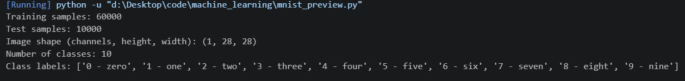
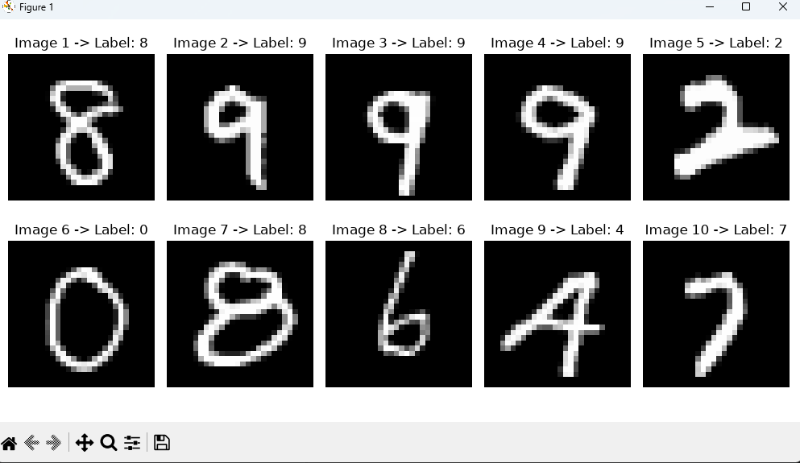
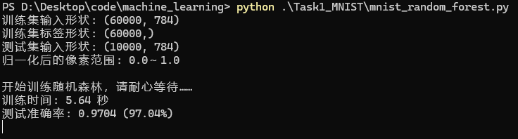
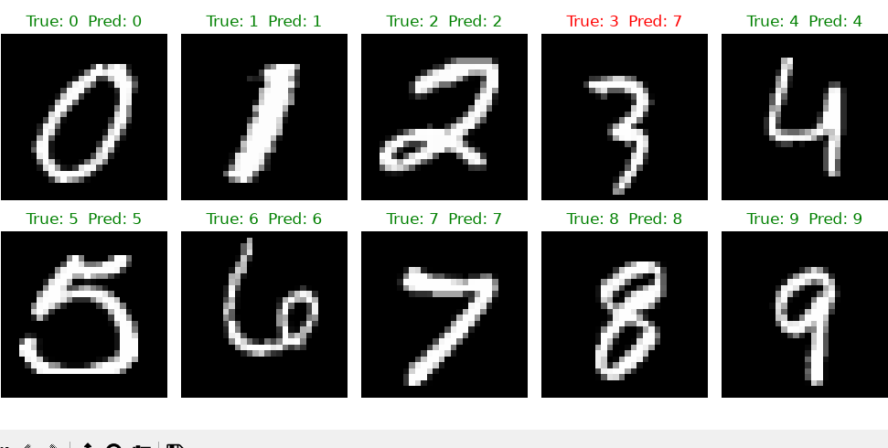

# 一，配置环境
安装依赖包
```bash
python -m pip install numpy matplotlib scikit-learn
python -m pip install torch torchvision --index-url https://download.pytorch.org/whl/cpu
```
# 二，下载数据集
```bash
python .\mnist_preview.py
```
第一次运行会自动下载 MNIST 数据，需要联网，下载好的数据会放在项目的 data 文件夹里。成功时会打印训练集和测试集的数量、图像尺寸、类别数量，并弹出 10 张手写数字图片。图像尺寸显示为 (1, 28, 28)，其中 1 表示灰度通道；脚本也会把像素值转换到 0 到 1 之间，方便后续模型处理。



# 运行随机森林分类
先关闭图片窗口，然后在项目目录运行随机森林模型：
```bash
python .\Task1_MNIST\mnist_random_forest.py
```
程序会：
- 读取 MNIST；
- 训练随机森林；
- 输出训练时间和测试准确率；
- 保存模型、混淆矩阵和预测图片；
- 最后弹出 10 张预测结果。

